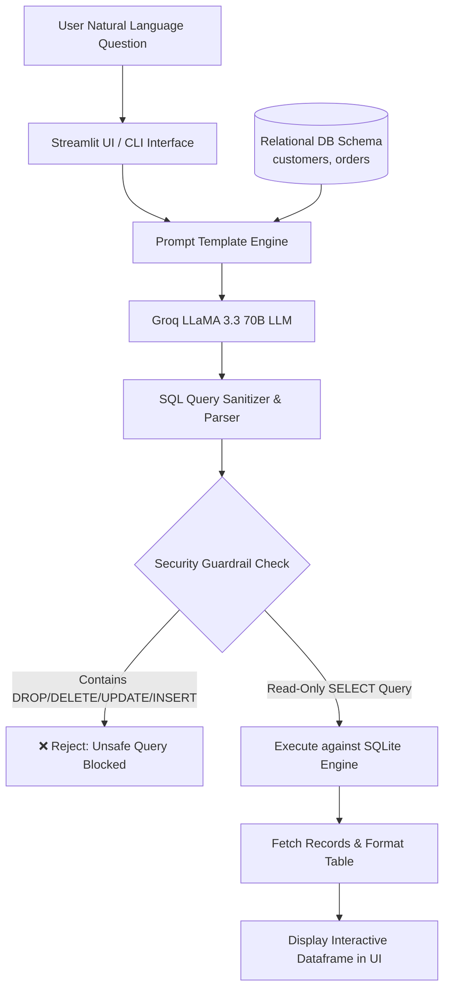

<div align="center">

# 🧠 Natural Language to Database Query System (Text-to-SQL)
### *Intelligent Natural Language Querying, Schema-Aware SQL Generation & Safe Execution Powered by LangChain and Groq LLMs*

[](https://www.python.org/)
[](https://streamlit.io/)
[](https://www.langchain.com/)
[](https://groq.com/)
[](https://www.sqlite.org/)
[](LICENSE)
[]()

<p align="center">
  <b>Bridge the gap between human language and relational databases.</b><br>
  Empower non-technical business users, analysts, and decision-makers to query structured relational databases using natural English questions with sub-second inference and strict security guardrails.
</p>

[Key Features](#-key-features) •
[Architecture](#-system-architecture) •
[Security & Guardrails](#-security--guardrails) •
[Getting Started](#-getting-started) •
[Example Queries](#-example-queries--demonstration) •
[Project Structure](#-project-structure) •
[Use Cases](#-use-cases)

</div>

---

## 📖 Overview

Querying relational databases typically requires in-depth proficiency in SQL syntax, database schema design, table relationships, and join constraints. Non-technical stakeholders often depend on data engineering teams just to retrieve routine business answers.

The **Natural Language to Database Query System (Text-to-SQL)** solves this challenge by leveraging **LangChain** and ultra-fast **Groq-hosted LLaMA 3.3 70B** models. The system converts arbitrary natural language questions into syntactically valid, schema-compliant SQL queries, enforces rigorous query safety policies, executes the query against SQLite, and presents structured tabular data in an intuitive **Streamlit** dashboard.

---

## ✨ Key Features

- 🗣️ **Conversational SQL Generation**: Formulate business questions in everyday English (e.g., *"Show customers from Cairo and their order amounts"*), without writing a single line of SQL.
- 📐 **Schema-Aware Prompting**: Injects relational table definitions, columns, and foreign key relationships directly into the prompt context to ensure precise joins and attribute matching.
- 🛡️ **Zero-Trust Query Safety Engine**: Proactively detects and rejects destructive data manipulation language (`DROP`, `DELETE`, `UPDATE`, `INSERT`) before database submission.
- ⚡ **Ultra-Fast LLM Inference**: Employs `llama-3.3-70b-versatile` via Groq's low-latency LPU inference engine for near-instant query generation.
- 🖥️ **Interactive Web Interface**: Clean, dual-pane Streamlit interface displaying the generated SQL statement and live interactive dataframes side-by-side.
- 💻 **Dual Execution Modes**: Flexible operation via interactive Streamlit Web UI (`appUI.py`) or headless command-line interface (`main.py`).
- 🧹 **Robust Output Sanitization**: Strips Markdown code blocks and extracts raw executable SQL statements seamlessly.

---

## 🏗️ System Architecture

The following diagram illustrates the complete pipeline from user natural language input to query validation and tabular visualization:



---

## 🛡️ Security & Guardrails

To prevent SQL injection and accidental database tampering, the system enforces multi-tiered security layers:

1. **System Prompt Guardrails**: The LLM is strictly prompted to only output `SELECT` queries and forbidden from producing DDL or DML statements.
2. **Deterministic Python Validation Layer**: Before the SQLite driver receives any generated string, an independent regex and keyword validator inspects the statement. If any mutation token (`DROP`, `DELETE`, `UPDATE`, `INSERT`, `ALTER`, `TRUNCATE`) is discovered, execution is aborted immediately with an explicit security warning.
3. **Execution Isolation**: SQLite connection cursors operate within safe read contexts.

---

## 📋 Database Schema

The built-in sample SQLite database (`data/sample.db`) models an e-commerce workflow with two relational tables:

```sql
-- Customers Table
CREATE TABLE customers (
    id INTEGER PRIMARY KEY,
    name TEXT NOT NULL,
    city TEXT NOT NULL
);

-- Orders Table
CREATE TABLE orders (
    id INTEGER PRIMARY KEY,
    customer_id INTEGER,
    amount REAL,
    FOREIGN KEY(customer_id) REFERENCES customers(id)
);
```

---

## 📥 Example Queries & Demonstration

| Natural Language Question | Generated SQL Query | Result Description |
| :--- | :--- | :--- |
| **"Show all customers"** | `SELECT * FROM customers;` | Lists all customer profiles |
| **"Show customers from Cairo"** | `SELECT * FROM customers WHERE city = 'Cairo';` | Filters customers by location |
| **"Show customer names and their order amounts"** | `SELECT customers.name, orders.amount FROM customers JOIN orders ON customers.id = orders.customer_id;` | Computes relational inner join |
| **"Delete customer Ali"** *(Adversarial)* | `DELETE FROM customers WHERE name = 'Ali';` | **Blocked**: Unsafe query alert triggered |

---

## 🚀 Getting Started

### Prerequisites

- **Python**: Version 3.10 or higher
- **Groq Cloud API Key**: Free API key from [Groq Console](https://console.groq.com)

### 1. Clone the Repository

```bash
git clone https://github.com/tasneemibrahim-ai/Natural-Language-to-Database-Query-System.git
cd Natural-Language-to-Database-Query-System
```

### 2. Set Up Virtual Environment

```bash
# Windows
python -m venv .venv
.venv\Scripts\activate

# macOS / Linux
python3 -m venv .venv
source .venv/bin/activate
```

### 3. Install Dependencies

```bash
pip install -r requirements.txt
```

### 4. Configure Environment Variables

Create your local `.env` file from the provided template:

```bash
# Windows (PowerShell)
Copy-Item .env.example .env

# Linux / macOS
cp .env.example .env
```

Open `.env` and add your Groq API key:

```env
GROQ_API_KEY=gsk_your_actual_groq_api_key_here
```

### 5. Initialize the Database

Run the database setup script to seed `data/sample.db`:

```bash
python setup_db.py
```

### 6. Launch the Application

#### Option A: Streamlit Interactive Web Application
```bash
# Recommended: Full-featured dashboard with schema viewer & CSV export
streamlit run streamlit_app.py

# Or classic quick-query interface
streamlit run appUI.py
```
*Navigate to `http://localhost:8501` in your browser.*

#### Option B: Command Line Interface (CLI)
```bash
python main.py
```

---

## 📂 Project Structure

```text
Natural-Language-to-Database-Query-System/
├── .env.example                                                   # Template for environment variables
├── .gitignore                                                     # Git ignore rules (protects API keys & local DBs)
├── streamlit_app.py                                               # Full-featured Streamlit UI (schema sidebar, quick queries, CSV download)
├── appUI.py                                                       # Streamlit web application interface
├── main.py                                                        # CLI & core orchestration entrypoint
├── chains.py                                                      # LangChain prompt templates & LCEL execution chain
├── utils.py                                                       # SQL extraction, zero-trust regex validation & SQLite runner
├── db_setup.py                                                    # Relational schema setup (users, products, orders) & seeder
├── sql_chain.py                                                   # Legacy LangChain chain helper
├── requirements.txt                                               # Python project dependencies
├── App demo text.txt                                              # Step-by-step demonstration walkthrough
├── App report.docx                                                # Formal project report documentation
├── Natural Language to Database Query System (Text-to-SQL).pdf    # Project presentation & executive report
└── README.md                                                      # Project documentation
```

---

## 💡 Use Cases

- 📊 **Self-Service Business Intelligence**: Empower non-technical department managers to query revenue, inventory, and customer databases on demand.
- ⚡ **Accelerated Analytics**: Rapidly generate prototype queries without hunting through massive database dictionaries.
- 🎓 **Educational Database Tooling**: Help students learn relational database querying by comparing natural language intents with generated SQL output.

---

## 🤝 Contributing & License

Contributions, issues, and feature requests are welcome!

Distributed under the **MIT License**. See `LICENSE` for more information.

**Author:** [Tasneem Ibrahim](https://github.com/tasneemibrahim-ai)